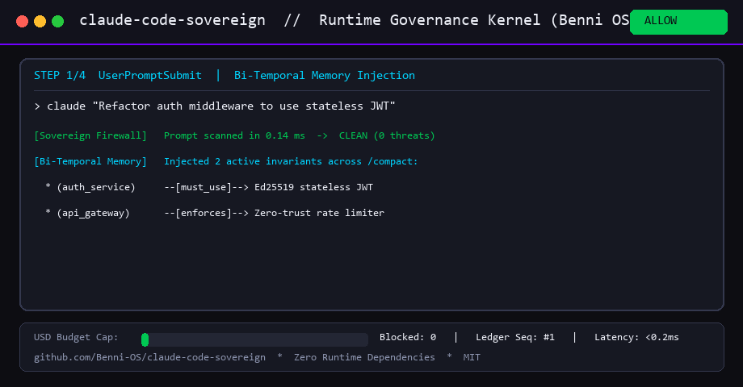

<div align="center">


<br/>

[](#-benchmarks--governance-latency-matrix)
[](https://www.python.org/)
[](#-why-claude-code-sovereign)
[](#-native-mcp-server--hook-protocol)
[](LICENSE)
[](https://benni-os.net)

<br/>

> **Zero-Dependency Runtime Governance Kernel, Prompt-Injection Firewall, Economic Circuit Breaker & Deterministic Time-Travel Replay for Anthropic Claude Code.**  
> Sub-millisecond `PreToolUse` / `PostToolUse` / `UserPromptSubmit` / `Stop` enforcement, SHA-256 immutable trajectory logging, and cross-session bi-temporal memory — in pure Python 3.10+ stdlib.

<br/>



</div>

---

## ⚡ Why `claude-code-sovereign`?

Autonomous coding agents operating inside your local shell have direct access to `Bash`, `Read`, `Write`, `Edit`, and `WebFetch`. Without a deterministic runtime kernel, a single indirect prompt injection, runaway subagent loop, or unverified edit can leak credentials, wipe files, or burn API budgets silently.

**`claude-code-sovereign`** enforces Tier-0 governance directly inside Claude Code's official Lifecycle Hook & MCP protocols:

- **Sub-Millisecond Prompt-Injection & Exfiltration Firewall** — Scans `PreToolUse` and `UserPromptSubmit` payloads in **0.0046 ms (P50)** (`~145K–173K ops/sec`), blocking indirect HTML comment injections, `sk-ant-`/`ghp_`/`AKIA` credential leaks, `.env`/`id_rsa` reads, `rm -rf /`, `curl | sh`, and workspace path traversal.
- **Economic Circuit Breaker (`BudgetGovernor`)** — Tracks per-session and per-subagent token & USD spend in SQLite3 WAL, issuing soft `additionalContext` warnings at **80%** and hard `deny`/`block` enforcement at **100%**.
- **Immutable SHA-256 Trajectory Ledger & `$0.00` Time-Travel Replay** — Seals every tool call and hook decision into a hash-chained `.sovereign/trace.jsonl` + SQLite3 ledger (`GENESIS_HASH`), enabling **$0.00 offline counterfactual replay** under tighter budgets or stricter firewall rules.
- **AST Syntax & Spec-Driven Reality Lock (`DriftLock`)** — Validates Python `ast.parse()`, JS/TS delimiter balance, merge conflict markers, and `.claude/spec.json` contracts on `Stop` and `SubagentStop` before letting Claude Code finish.
- **Bi-Temporal Cross-Session Memory** — Persists architectural invariants (`valid_from`, `valid_until`, `recorded_at`) across `/compact` and `/clear`, automatically re-injecting active constraints on `UserPromptSubmit`.
- **One-Command Idempotent `.claude/` Injection (`claude-sovereign init`)** — Safely configures `.claude/settings.json`, `.mcp.json`, `CLAUDE.md`, and 4 slash commands (`/sovereign-audit`, `/sovereign-replay`, `/sovereign-budget`, `/sovereign-spec`) without clobbering existing settings.

---

## 🏗️ Architecture

```text
  Anthropic Claude Code CLI / Subagents
         │
         ├──► Lifecycle Hooks (stdin/stdout JSON: PreToolUse, PostToolUse, UserPromptSubmit, Stop, SubagentStop)
         └──► Native MCP Server (stdio JSON-RPC 2.0: claude-sovereign mcp)
                       │
                       ▼
  ┌─────────────────────────────────────────────────────────────────────┐
  │                      claude-code-sovereign                          │
  │                                                                     │
  │  ┌───────────────────┐  ┌───────────────────┐  ┌─────────────────┐  │
  │  │ SovereignFirewall │  │  BudgetGovernor   │  │   DriftLock     │  │
  │  │ • Prompt Injection│─►│  • 80% Soft Warn  │─►│ • Python AST    │  │
  │  │ • Secret/PII Guard│  │  • 100% Hard Deny │  │ • JS/TS Syntax  │  │
  │  │ • Shell/PathShield│  │  • Per-Subagent   │  │ • .claude/spec  │  │
  │  └───────────────────┘  └───────────────────┘  └─────────────────┘  │
  │                                                                     │
  │  ┌───────────────────┐  ┌───────────────────┐  ┌─────────────────┐  │
  │  │    TraceLedger    │  │ BiTemporalMemory  │  │ Health & Bench  │  │
  │  │ • SHA-256 Chain   │  │ • Survives        │  │ • P50/P90/P99   │  │
  │  │ • $0.00 Offline   │  │   /compact &      │  │ • SQLite3 WAL   │  │
  │  │   Counterfactual  │  │   /clear          │  │ • doctor/matrix │  │
  │  └───────────────────┘  └───────────────────┘  └─────────────────┘  │
  └─────────────────────────────────────────────────────────────────────┘
         │                                         │
         ▼                                         ▼
   .sovereign/trace.jsonl                   .sovereign/sovereign.db
   (Append-Only SHA-256 Log)                (SQLite3 WAL: Ledger, Budget, Graph)
```

---

## 🚀 60-Second Quickstart

```bash
# 1. Clone and install (zero runtime dependencies)
git clone https://github.com/Benni-OS/claude-code-sovereign
cd claude-code-sovereign
pip install -e .

# 2. Probe your Claude Code environment & hook pipeline
claude-sovereign doctor

# 3. Inject Sovereign Hooks, MCP Server, CLAUDE.md & Slash Commands into any repo
claude-sovereign init --path /path/to/your-project

# 4. Run the multi-scale firewall & hook latency benchmark matrix
claude-sovereign matrix

# 5. Run the quickstart examples
python examples/quickstart_claude_hook.py
python examples/quickstart_sovereign_session.py
```

### Key CLI Commands

```bash
claude-sovereign init --path .                 # Idempotently inject .claude/, .mcp.json & CLAUDE.md
claude-sovereign hook PreToolUse               # Official Claude Code JSON stdin/stdout hook dispatcher
claude-sovereign mcp                           # Launch zero-dependency JSON-RPC 2.0 stdio MCP server
claude-sovereign doctor                        # Probe Python, Claude CLI, hook pipeline & workspace health
claude-sovereign matrix --scales 100 500 1000  # Multi-scale firewall & SQLite3 WAL benchmark matrix
claude-sovereign status --session default      # Inspect USD/token budget & P50/P90/P99 telemetry
claude-sovereign replay --cap-usd 0.50         # Run $0.00 offline counterfactual trajectory replay
claude-sovereign audit                         # Verify .claude/ config, SQLite3 WAL & SHA-256 chain
```

---

## 📊 Benchmarks & Governance Latency Matrix

Measured on Python 3.11.0 (Windows 10/11, NVMe SSD, zero external dependencies):

### 1. In-Memory `SovereignFirewall` Throughput

| Iterations | Throughput | P50 Latency | P90 Latency | P99 Latency |
|---:|---:|---:|---:|---:|
| **100** | **173,250.2 ops/s** | `0.0046 ms` | `0.0083 ms` | `0.0300 ms` |
| **500** | **168,833.4 ops/s** | `0.0046 ms` | `0.0096 ms` | `0.0239 ms` |
| **1,000** | **145,904.5 ops/s** | `0.0046 ms` | `0.0139 ms` | `0.0290 ms` |

### 2. End-to-End `HookEngine` + SQLite3 WAL + SHA-256 `TraceLedger` (100 Sequential Calls)

| Metric | Measured Result |
|---|---|
| **Throughput** | `43.3 ops/s` (full disk-synced WAL + JSONL append) |
| **P50 Latency** | `6.5403 ms` |
| **P90 Latency** | `68.3167 ms` |
| **P99 Latency** | `108.6883 ms` |
| **SHA-256 Chain Integrity** | `100% Verified` (`ChainVerified=True`) |
| **Pytest Suite** | `27/27 Passed` in `2.66s` |

---

## 🔌 Native MCP Server & Hook Protocol

`claude-sovereign mcp` exposes **7 Sovereign MCP Tools** over stdio JSON-RPC 2.0:

| MCP Tool | Purpose |
|---|---|
| `sovereign_firewall_scan` | Scan a tool call or prompt text for injections, secrets, or destructive shell commands |
| `sovereign_budget_status` | Query current session USD & token budget utilization + subagent breakdown |
| `sovereign_trace_inspect` | Inspect SHA-256 chained trajectory events and verify chain integrity |
| `sovereign_trace_replay` | Run `$0.00` deterministic offline counterfactual replay against new budget/policy caps |
| `sovereign_memory_query` | Query the bi-temporal knowledge graph (`subject`, `predicate`, `as_of_valid`) |
| `sovereign_memory_record` | Persist architectural decisions and invariants across `/compact` and `/clear` |
| `sovereign_sdd_verify` | Run Python AST, JS/TS syntax, and `.claude/spec.json` Reality Lock checks |

---

## 🗂️ Project Structure

```text
claude-code-sovereign/
├── pyproject.toml                        # Zero-dependency PEP 621 package & CLI entrypoint
├── LICENSE                               # MIT License (Benni Alencar)
├── docs/
│   └── ARCHITECTURE.md                   # Deep architectural & cryptographic specification
├── assets/
│   └── demo.gif                          # Animated runtime governance & firewall demo
├── src/
│   └── claude_code_sovereign/
│       ├── __init__.py                   # Public package exports
│       ├── cli.py                        # CLI entrypoint (init, hook, mcp, doctor, matrix, status, replay, audit)
│       ├── core/
│       │   ├── hook_engine.py            # Official Claude Code Lifecycle Hook stdin/stdout dispatcher
│       │   ├── firewall.py               # Sub-ms prompt injection, secret & destructive shell shield
│       │   ├── budget_governor.py        # Per-session & per-subagent USD/token circuit breaker
│       │   ├── trace_ledger.py           # SHA-256 chained JSONL + SQLite3 ledger & $0.00 replay
│       │   ├── drift_lock.py             # AST syntax verifier & Spec-Driven Reality Lock gate
│       │   ├── bitemporal_memory.py      # Cross-session bi-temporal knowledge graph
│       │   └── injector.py               # Idempotent .claude/, .mcp.json, CLAUDE.md & commands injector
│       ├── serve/
│       │   ├── mcp_server.py             # Zero-dependency JSON-RPC 2.0 stdio MCP server (7 tools)
│       │   ├── telemetry.py              # Rolling P50/P90/P99 latency, blocked attacks & USD saved
│       │   └── health_monitor.py         # .claude/ config, SQLite3 WAL & SHA-256 integrity monitor
│       └── tools/
│           ├── doctor.py                 # Full environment & hook pipeline diagnostic (doctor)
│           └── bench_matrix.py           # Multi-scale firewall & hook latency matrix (matrix)
├── examples/
│   ├── quickstart_claude_hook.py         # PreToolUse allow/deny + SHA-256 chain quickstart
│   └── quickstart_sovereign_session.py   # Bi-temporal memory + budget + $0.00 replay quickstart
├── scripts/
│   ├── benchmark_hook_latency.py         # Extended multi-scale latency benchmark runner
│   └── gate_sovereign_integrity.py       # End-to-end Sovereign integrity verification gate
└── tests/                                # 27-test pytest suite (hooks, firewall, budget, ledger, MCP, CLI)
```

---

## 🌍 Part of the Benni OS Ecosystem

`claude-code-sovereign` is part of the coordinated **Benni Master OS v9.4** open-source infrastructure suite:

| Repository | Focus & Architecture | Stars |
| :--- | :--- | :---: |
| **[`claude-code-sovereign`](https://github.com/Benni-OS/claude-code-sovereign)** | Zero-Dependency Runtime Governance Kernel, Firewall & Time-Travel Replay for Claude Code | [](https://github.com/Benni-OS/claude-code-sovereign) |
| **[`conductor-sdd`](https://github.com/Benni-OS/conductor-sdd)** | Zero-Dependency Spec-Driven Development, Static AST Drift Detector & MCP Guardrail | [](https://github.com/Benni-OS/conductor-sdd) |
| **[`benni-inference-engine`](https://github.com/Benni-OS/benni-inference-engine)** | High-Throughput Sovereign Local Inference for 8GB–16GB Consumer GPUs | [](https://github.com/Benni-OS/benni-inference-engine) |
| **[`agent-eval-harness`](https://github.com/BenniAlencar/agent-eval-harness)** | Deterministic Zero-Cloud Agent Evaluation, Red-Teaming & Benchmark Harness | [](https://github.com/BenniAlencar/agent-eval-harness) |
| **[`agent-cyber-sentinel`](https://github.com/BenniAlencar/agent-cyber-sentinel)** | Zero-Trust Runtime Security, Prompt Injection Firewall & Secrets Redaction | [](https://github.com/BenniAlencar/agent-cyber-sentinel) |

---

## 🏛️ Commercial & Sovereign Architecture

Need autonomous multi-agent swarm orchestration, private datacenter infrastructure, or enterprise governance?

- **Official Website:** [https://benni-os.net](https://benni-os.net)
- **Operator Mode Playbook:** [https://benni-os.net/blog/academy.html](https://benni-os.net/blog/academy.html)
- **GitHub Organization:** [https://github.com/Benni-OS](https://github.com/Benni-OS)
- **Maintainer:** [Benni Alencar](https://github.com/BenniAlencar)

---

## 📄 License & Provenance

- **License:** [MIT License](LICENSE)
- **Author:** Benni Alencar (`bennialencar@benni-os.net`)
- **Architecture:** Benni Master OS v9.4 Tier-0 Governance Standard

<div align="center">


**claude-code-sovereign** — *Zero-Dependency Runtime Governance Kernel for Claude Code* • [benni-os.net](https://benni-os.net) • `MIT License`

</div>
